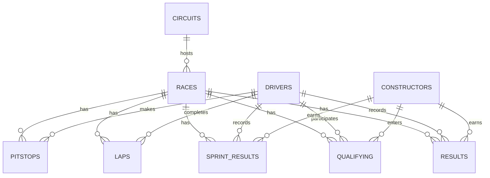

# Formula 1 Data Engineering Pipeline

An end-to-end ETL pipeline that extracts historical Formula 1 racing data from the Jolpica API, transforms nested JSON responses into structured records, and loads them into a PostgreSQL database.

The pipeline is containerized using Docker and orchestrated with Kestra, allowing users to execute historical backfills, refresh existing datasets, and selectively process different F1 data endpoints.

## Project Overview

This project demonstrates the design and implementation of a data engineering pipeline for collecting, processing, and storing Formula 1 racing data.

The pipeline supports nine datasets:

- Drivers
- Constructors
- Circuits
- Races
- Race results
- Qualifying results
- Lap times
- Pit stops
- Sprint results

**Key capabilities include:**

- **Historical backfills:** Extract historical data across supported seasons.
- **Data refreshes:** Re-extract and replace previously downloaded raw data.
- **Selective processing:** Execute the pipeline for one or multiple endpoints.
- **Incremental API pagination:** Retrieve paginated responses from the Jolpica API.
- **Data transformation:** Convert nested API responses into relational records.
- **Idempotent loading:** Use PostgreSQL upserts to insert new records and update existing records without creating duplicates.
- **Data validation:** Prevent transformations from processing incomplete extractions.
- **Failure handling:** Use database transactions to roll back failed loads and support retries of failed refreshes.
- **Workflow orchestration:** Coordinate extraction and loading tasks through Kestra.

The project is designed as a reproducible, locally deployable data pipeline using Python, PostgreSQL, Docker, and Kestra.

## Pipeline Architecture

```text
                  Kestra
             (Orchestration)
                    |
                    v
             Jolpica F1 API
                    |
                    v
            Python Extraction
               extract.py
                    |
                    v
               Raw JSON
               data/raw/
                    |
                    v
           Python Transformation
              transform.py
                    |
                    v
            PostgreSQL Loading
                load.py
                    |
                    v
             PostgreSQL
            (f1 schema)
```

### Data Flow

1. **Extract:** `extract.py` retrieves paginated Formula 1 data from the Jolpica API and stores the responses as raw JSON files.
2. **Validate and transform:** `transform.py` verifies that extraction is complete and converts nested JSON data into structured records.
3. **Load:** `load.py` inserts or updates records in PostgreSQL using transactional upserts.
4. **Orchestrate:** Kestra coordinates the extraction and transformation/loading tasks, using Docker to run the ETL containers.

The workflow supports configurable season ranges, endpoint selection, and backfill or refresh execution modes.

<WritingBlock id="68241" variant="document"> Technology Stack
Technology	Purpose
Python	API extraction, JSON transformation, data validation, and database loading
PostgreSQL	Relational storage for Formula 1 data, including transactional upserts
Docker & Docker Compose	Containerized execution and management of supporting services
Kestra	Workflow orchestration, configurable inputs, and execution monitoring
Jolpica F1 API	Source of historical Formula 1 racing data
SQL	Database schema definition, relational modeling, and data querying
Git & GitHub	Version control and project publication

Pipeline Components
- scripts/extract.py — Retrieves API data and manages backfill and refresh operations.
- scripts/transform.py — Validates raw files and transforms JSON responses into relational records.
- scripts/load.py — Loads transformed records into PostgreSQL.
- sql/schema.sql — Defines the database schema and tables.
- kestra/f1_etl_pipeline.yaml — Defines the orchestrated workflow.
- Dockerfile — Builds the Python ETL container image.
- docker-compose.yaml — Configures PostgreSQL, pgAdmin, and Kestra services.
- tests/ — Contains verification scripts for extraction, validation, loading, and failure handling.</WritingBlock>


## Database Schema

The pipeline stores Formula 1 data in nine relational tables under the PostgreSQL `f1` schema.

### Tables

| Table | Description | Primary Key |
|---|---|---|
| `drivers` | Driver profiles and nationality | `driver_id` |
| `constructors` | Formula 1 teams | `constructor_id` |
| `circuits` | Circuit locations and geographic coordinates | `circuit_id` |
| `races` | Race calendar information | `season, round` |
| `results` | Race results, points, finishing positions, and lap statistics | `season, round, driver_id` |
| `qualifying` | Qualifying positions and Q1/Q2/Q3 lap times | `season, round, driver_id` |
| `laps` | Individual driver lap times and positions | `season, round, driver_id, lap_number` |
| `pitstops` | Driver pit stops, lap numbers, and durations | `season, round, driver_id, stop` |
| `sprint_results` | Sprint race results and points | `season, round, driver_id` |

### Entity Relationships



### Data Modeling

- **Primary keys:** Every table has a defined primary key to prevent duplicate records.
- **Composite keys:** Race-related tables use combinations of season, round, driver, lap, or stop identifiers to uniquely identify records.
- **Foreign keys:** Referential integrity is enforced between race events, drivers, constructors, and circuits.
- **Relational structure:** Driver, constructor, circuit, and race information is stored separately from detailed performance records.
- **Upserts:** PostgreSQL `INSERT ... ON CONFLICT` operations allow existing records to be updated without creating duplicates.

The complete schema definition is available in [`sql/schema.sql`](sql/schema.sql).


## Getting Started

### Prerequisites

- Docker Desktop with Docker Compose
- Git
- A local copy of this repository

Python does not need to be installed locally to execute the ETL pipeline because the Python scripts run inside Docker containers.

### 1. Clone the Repository

```bash
git clone https://github.com/YOUR_USERNAME/YOUR_REPOSITORY.git
cd YOUR_REPOSITORY
```

Replace the placeholder repository URL and directory with the actual GitHub repository details.

### 2. Configure Environment Variables

Create a local `.env` file from the provided template:

```bash
cp .env.example .env
```

Update `.env` with your local PostgreSQL credentials, pgAdmin credentials, and the absolute path to the raw data directory.

For `F1_RAW_DATA_PATH`, use the absolute path to the project's `data/raw` directory.

Create the directory if it does not already exist:

```bash
mkdir -p data/raw
```

The `.env` file and raw data directory are excluded from Git.

### 3. Build the ETL Docker Image

```bash
docker build -t f1-etl:dev .
```

This builds the Python environment used by Kestra to execute the ETL scripts.

### 4. Start the Infrastructure

```bash
docker compose up -d
```

Docker Compose starts PostgreSQL, pgAdmin, and Kestra.

On first initialization, PostgreSQL automatically executes `sql/schema.sql` to create the `f1` schema and its nine relational tables.

The following services are available locally:

| Service | URL / Connection |
|---|---|
| Kestra | http://localhost:8080 |
| pgAdmin | http://localhost:8050 |
| PostgreSQL | localhost:5432 |

### 5. Import the Kestra Workflow

1. Open Kestra at http://localhost:8080.
2. Navigate to **Flows**.
3. Create a new flow using the contents of `kestra/f1_etl_pipeline.yaml`.
4. Save the flow under the `f1` namespace.

The workflow contains two tasks:

- `extract_f1_data` — Extracts Formula 1 data from the Jolpica API.
- `transform_and_load` — Validates, transforms, and loads the data into PostgreSQL.

### 6. Execute the Pipeline

Open the `f1_etl_pipeline` flow in Kestra and start an execution.

Configure the workflow inputs:

| Input | Description | Default |
|---|---|---|
| `start_season` | First season to process | `2025` |
| `end_season` | Last season to process | `2025` |
| `endpoints` | F1 datasets to process | All nine endpoints |
| `mode` | Historical backfill or refresh | `backfill` |

For the first execution, use **backfill** mode with all endpoints selected to populate the foundational tables before processing dependent datasets.

Subsequent executions can target specific endpoints or use refresh mode to retrieve updated data.

### 7. Verify the Loaded Data

Connect to PostgreSQL through pgAdmin or another SQL client using the database credentials configured in `.env`.

Run:

```sql
SELECT COUNT(*) FROM f1.drivers;
SELECT COUNT(*) FROM f1.races;
SELECT COUNT(*) FROM f1.results;
```

Successful execution should return records for the selected datasets.

### 8. Stop the Infrastructure

```bash
docker compose down
```

This stops and removes the project containers while preserving data stored in Docker volumes.